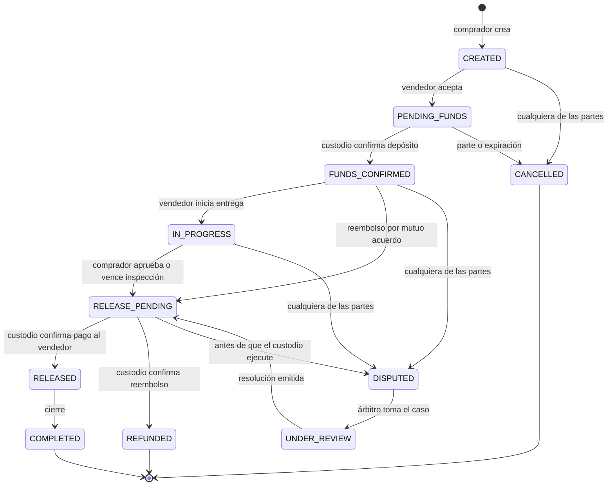

# WordVerse — Escrow: Análisis del Modelo, Evaluación Técnica y Diseño Funcional

> **Estado del documento:** BORRADOR PARA REVISIÓN — Fase 5 (Fases A, C y D del Prompt 5).
> **Estado del módulo:** NO APTO PARA PRODUCCIÓN. Sin aprobación jurídica ni técnica.
> **Alcance:** diseño y análisis. No se ha desplegado contrato alguno, no se custodian fondos, no se ejecutan transferencias y no se solicitan claves privadas.

---

## 0. Auditoría del estado actual (evidencia)

### 0.1 Lo que existe hoy

| Componente | Archivo | Comportamiento real |
| :--- | :--- | :--- |
| Contrato de servicio | `lib/core/api_client/escrow_service.dart` | `listEscrows`, `createEscrow`, `transitionEscrowState(escrowId, actorUserId, targetStatus)` |
| Modelo | `lib/core/models/shest_models.dart` (`EscrowOperation`, `EscrowStatus`) | 8 estados: `PENDING, FUNDED, IN_PROGRESS, RELEASE_REQUESTED, RELEASED, DISPUTED, CANCELLED, COMPLETED`. `historyLog` es `List<String>` sin actor ni marca de tiempo estructurada. |
| Simulación | `lib/core/mocks/mock_shest_api.dart` | Saldos en memoria. Al pasar a `FUNDED` descuenta al creador; al pasar a `RELEASED`/`COMPLETED` acredita a la contraparte. |
| Adaptador HTTP | `lib/core/api_client/http_shest_api.dart` | Ejecuta primero el mock y luego hace `PATCH /escrows?id=eq.{id}` con `{"estado": ...}` **directamente desde el cliente** contra Supabase. |
| Contrato API Shest | `docs/00_contrato_api_shest_fase0.md` | `PATCH /escrows/{id}/state` — establece que la validación de permisos y fondos debe ocurrir en el backend Java. |

Todo lo anterior opera con **saldos ficticios en memoria**. No hay conexión con billeteras reales.

### 0.2 Defectos confirmados mediante sonda de pruebas

Sonda ejecutada el 2026-10-29 (archivada fuera de la suite en `scratch/escrow_audit_probe_test.dart`):

| ID | Escenario | Resultado observado | Esperado | Severidad |
| :--- | :--- | :--- | :--- | :---: |
| **ESC-D1** | Crear escrow de 1.000 y pasar `PENDING → RELEASED` sin fondear | Creador 12.500 → 12.500; contraparte 48.000 → **49.000** | Rechazo de la transición | **Crítica** (creación de saldo inexistente) |
| **ESC-D2** | Fondear 500 y luego `FUNDED → CANCELLED` | Creador 12.500 → **12.000** (no hay reembolso) | Reembolso de 500 al creador | **Crítica** (pérdida de saldo) |
| **ESC-D3** | Actor ajeno (`usr_4_ajeno`) ejecuta `RELEASED → DISPUTED → RELEASED` | Contraparte recibe **+200** por un escrow de 100 | Rechazo por actor no autorizado y por liberación duplicada | **Crítica** (doble liberación + sin autorización) |
| **ESC-D4** | `HttpShestApi` modifica `estado` vía PostgREST desde el cliente | Con las políticas RLS actuales (`RSK-01`, `using (true)`) cualquier cliente con la clave anónima podría marcar un escrow como `RELEASED` | Solo el backend autoritativo cambia estados | **Crítica** si se conecta a datos reales |
| **ESC-D5** | `historyLog` | Texto libre sin actor, sin hora y sin hash | Registro de auditoría inmutable y estructurado | Alta |
| **ESC-D6** | Idempotencia | No existe clave de idempotencia; un reintento repite el efecto | Reintentos seguros | Alta |

> [!CAUTION]
> Estos defectos se encuentran en la **simulación** y en el adaptador del cliente. Mientras no se corrijan, el módulo Escrow no debe conectarse a ningún backend con saldos reales, ni siquiera de staging compartido.

---

## 1. Fase A — Análisis del modelo

> Los puntos marcados como **[SUPUESTO]** no provienen de un requisito confirmado del cliente y deben validarse. No se encontraron audios del cliente en el repositorio (ver ADR-005); no se infiere ningún requisito de ellos.

### 1.1 Participantes y responsabilidades

| Participante | Rol | Responsabilidades |
| :--- | :--- | :--- |
| **Comprador / Depositante** (`creator`) | Aporta los fondos | Crear el acuerdo, definir condiciones, depositar, confirmar recepción, solicitar cancelación o abrir disputa. |
| **Vendedor / Beneficiario** (`counterparty`) | Recibe los fondos | Aceptar el acuerdo, cumplir la entrega, aportar evidencias, solicitar la liberación, abrir disputa. |
| **Custodio** | Mantiene los fondos | **Por definir.** WordVerse no debe serlo (ADR-001). Opciones en §3. |
| **Árbitro / Revisor** | Resuelve disputas | **[SUPUESTO]** Equipo de operaciones de Shest o tercero autorizado. Requiere definición contractual. |
| **Plataforma WordVerse** | Interfaz y orquestación | Presentar el flujo, recolectar evidencias, mostrar estados. **No** decide liberaciones ni mueve fondos. |
| **Backend Shest Labs** | Fuente de verdad | Validar actores, transiciones, saldos e idempotencia; ordenar al custodio. |
| **Cumplimiento (KYC/AML)** | Control regulatorio | **[SUPUESTO]** Verificar identidad y monitorear operaciones según lo que determine la revisión jurídica. |

### 1.2 Activos involucrados

- **USDT sobre TRON (TRC20)** — es el único activo presente en el código actual.
- **[SUPUESTO]** Posible extensión a moneda fiat (las órdenes P2P referencian Wire/Zelle/ACH). Mezclar fiat y cripto en un mismo escrow cambia sustancialmente el análisis regulatorio.
- Bienes o servicios subyacentes (fuera de la plataforma): productos del Kiosco 3D, consultorías, suministros B2B.

### 1.3 Condiciones de liberación (propuesta)

1. Fondos confirmados por el custodio (`FUNDS_CONFIRMED`).
2. **Una** de las siguientes:
   - Confirmación explícita del comprador; o
   - Vencimiento del plazo de inspección sin objeción **[SUPUESTO: plazo a definir, p.ej. 72 h]**; o
   - Resolución de disputa a favor del vendedor emitida por el árbitro.
3. Sin disputa abierta.
4. Controles de cumplimiento superados.
5. Orden de liberación única (clave de idempotencia) aceptada por el custodio.

### 1.4 Condiciones de cancelación

| Momento | ¿Quién puede cancelar? | Efecto |
| :--- | :--- | :--- |
| `CREATED` / `PENDING_FUNDS` | Cualquiera de las partes | Cierre sin movimiento de fondos. |
| `FUNDS_CONFIRMED` (antes de iniciar) | Acuerdo mutuo | Reembolso íntegro al comprador → `REFUNDED`. |
| `IN_PROGRESS` en adelante | Nadie unilateralmente | Solo por disputa y resolución. |
| Expiración de `PENDING_FUNDS` | Sistema | `CANCELLED` automático **[SUPUESTO: plazo a definir]**. |

### 1.5 Reembolsos

- Solo al **origen** de los fondos (misma dirección/cuenta de depósito), para limitar riesgos de desvío y lavado.
- Política de comisiones en reembolso: **por definir** (comercial y jurídico).
- Reembolsos parciales: solo por resolución de disputa.

### 1.6 Disputas y evidencias

- Apertura: comprador o vendedor desde `FUNDS_CONFIRMED`, `IN_PROGRESS` o `RELEASE_PENDING`. Motivo obligatorio.
- Al abrirse, se **congela** cualquier liberación o reembolso.
- Evidencias: archivos, mensajes del chat de sala (con traducción IA conservando el original — Fase 3), registros de entrega, minutas de reunión. Cada evidencia se registra con hash (SHA-256), autor y hora.
- Resultados posibles: liberación total, reembolso total o reparto parcial. Solo el árbitro emite la resolución.
- Plazos de respuesta y apelación: **por definir** en términos y condiciones.

### 1.7 Responsabilidad de custodia

**No asignada.** Es la decisión central pendiente. Mientras no exista un custodio contratado y aprobado, ningún flujo puede manejar fondos reales.

### 1.8 Dependencias externas

| Dependencia | Estado |
| :--- | :--- |
| Backend Java Spring Boot de Shest (fuente de verdad) | Existe contrato v1; endpoints de escrow sin verificar en vivo. |
| Proveedor de custodia / pagos | No seleccionado. |
| Proveedor KYC/AML y monitoreo de transacciones | No seleccionado. |
| Red TRON (confirmaciones, comisiones en TRX) | Externa. |
| Emisor de USDT (Tether) — puede congelar direcciones | Externa, riesgo de contraparte. |
| Almacenamiento de evidencias | No definido. |

---

## 2. Fase C — Evaluación técnica de modelos de custodia

| Criterio | **A. Proveedor de custodia especializado** (API de custodia institucional con políticas multi-firma/MPC) | **B. Escrow administrado por tercero autorizado** (entidad licenciada que actúa como agente de escrow) | **C. Contrato inteligente en TRON** | **D. Custodia propia (WordVerse/Shest)** |
| :--- | :--- | :--- | :--- | :--- |
| Quién custodia | El proveedor | El tercero licenciado | El código del contrato | La plataforma |
| Seguridad | Alta (HSM/MPC, seguros según proveedor) | Alta, con respaldo legal | Depende de auditoría; errores son irreversibles | Depende 100 % de capacidades internas |
| Carga regulatoria para la plataforma | Media (el proveedor asume parte) | **La más baja** (el tercero asume la función de escrow) | Incierta; disputas requieren un oráculo/árbitro con poder sobre fondos, lo que reintroduce custodia | **La más alta** |
| Disputas | Por API/políticas del proveedor | Nativas del servicio | Requiere árbitro con firma → no es "sin confianza" | Internas |
| Recuperación ante fallos | Procedimientos del proveedor | Contractual | Muy limitada si hay errores en el contrato | Interna |
| Costo | Cuota + comisión por transacción | Comisión por operación (normalmente mayor) | Gas (TRX) + auditoría de seguridad | Infraestructura, seguridad, licencias, seguros |
| Disponibilidad | SLA del proveedor | SLA del tercero | Red TRON | Propia |
| Tiempo de implementación | Medio | Medio-bajo | Alto (desarrollo + auditoría) | Muy alto |
| Riesgo de congelamiento USDT | Presente | Presente | Presente | Presente |
| **Recomendación técnica preliminar** | **Opción preferente** si Shest mantiene control operativo | **Opción preferente** si se busca minimizar carga regulatoria | No recomendado como primera fase | **No recomendado** |

> [!IMPORTANT]
> La elección entre A y B depende principalmente de la revisión jurídica (§ documento 02). Esta tabla es una comparación técnica, no un dictamen de viabilidad legal. Los nombres de proveedores concretos se seleccionarán tras la revisión jurídica y un proceso de due diligence; no se asume ninguno contratado.

### 2.1 Arquitectura de registro y auditoría (independiente del modelo elegido)

- **Libro de eventos append-only** en el backend Shest: `escrow_events(id, escrow_id, seq, from_state, to_state, actor_id, actor_role, reason, idempotency_key, custodian_ref, created_at, prev_hash, hash)`.
- Encadenamiento de hashes (`hash = SHA-256(prev_hash || payload)`) para detectar manipulación.
- Proyección `escrows.state` derivada exclusivamente del libro; nunca escrita por el cliente.
- Conciliación periódica: suma de escrows en `FUNDS_CONFIRMED..RELEASE_PENDING + DISPUTED + UNDER_REVIEW` = saldo reportado por el custodio para la cuenta ómnibus/segregada.
- Retención de registros y evidencias según lo que determine la revisión jurídica.

---

## 3. Fase D — Diseño funcional

### 3.1 Estados propuestos

| Estado | Significado | ¿Fondos bajo custodia? | Terminal |
| :--- | :--- | :---: | :---: |
| `CREATED` | Acuerdo redactado por el comprador | No | No |
| `PENDING_FUNDS` | Aceptado por el vendedor; esperando depósito | No | No |
| `FUNDS_CONFIRMED` | Custodio confirmó depósito (N confirmaciones) | **Sí** | No |
| `IN_PROGRESS` | Vendedor inició la entrega | **Sí** | No |
| `RELEASE_PENDING` | Liberación solicitada/aprobada; orden enviada al custodio | **Sí** | No |
| `RELEASED` | Custodio confirmó la transferencia al vendedor | No | No |
| `COMPLETED` | Cierre administrativo tras liberación | No | **Sí** |
| `CANCELLED` | Cerrado sin que existieran fondos | No | **Sí** |
| `REFUNDED` | Fondos devueltos al comprador (confirmado por custodio) | No | **Sí** |
| `DISPUTED` | Disputa abierta; liberaciones congeladas | **Sí** | No |
| `UNDER_REVIEW` | Árbitro analizando evidencias | **Sí** | No |

**Correspondencia con los estados actuales del código:** `PENDING → CREATED/PENDING_FUNDS`, `FUNDED → FUNDS_CONFIRMED`, `RELEASE_REQUESTED → RELEASE_PENDING`; se agregan `REFUNDED` y `UNDER_REVIEW`. La migración del enum se hará en el prototipo, con compatibilidad del valor de API anterior.

### 3.2 Diagrama de estados



`RELEASE_PENDING` lleva un atributo `direction ∈ {TO_SELLER, TO_BUYER, SPLIT}` fijado una sola vez al entrar.

### 3.3 Matriz de transiciones y actores autorizados

| # | Desde | Hacia | Actor autorizado | Precondiciones / controles |
| :-: | :--- | :--- | :--- | :--- |
| T1 | `CREATED` | `PENDING_FUNDS` | Vendedor | KYC de ambas partes vigente [SUPUESTO] |
| T2 | `CREATED` | `CANCELLED` | Comprador o vendedor | — |
| T3 | `PENDING_FUNDS` | `FUNDS_CONFIRMED` | **Sistema** (webhook firmado del custodio) | Monto y activo exactos; N confirmaciones; webhook verificado |
| T4 | `PENDING_FUNDS` | `CANCELLED` | Parte o sistema (expiración) | Sin depósito confirmado |
| T5 | `FUNDS_CONFIRMED` | `IN_PROGRESS` | Vendedor | — |
| T6 | `FUNDS_CONFIRMED` | `RELEASE_PENDING (TO_BUYER)` | Ambas partes (doble aprobación) | — |
| T7 | `FUNDS_CONFIRMED`/`IN_PROGRESS`/`RELEASE_PENDING` | `DISPUTED` | Comprador o vendedor | Motivo obligatorio; en `RELEASE_PENDING` solo si el custodio no ha ejecutado |
| T8 | `IN_PROGRESS` | `RELEASE_PENDING (TO_SELLER)` | Comprador, o sistema por vencimiento | Sin disputa abierta |
| T9 | `DISPUTED` | `UNDER_REVIEW` | Árbitro | — |
| T10 | `UNDER_REVIEW` | `RELEASE_PENDING (dirección según resolución)` | Árbitro | Resolución documentada y firmada |
| T11 | `RELEASE_PENDING` | `RELEASED` / `REFUNDED` | **Sistema** (confirmación del custodio) | Coincide con `direction` y con la orden única |
| T12 | `RELEASED` | `COMPLETED` | Sistema | — |

**Reglas generales:**
- Cualquier transición no listada se rechaza (`ESCROW_INVALID_TRANSITION`).
- El vendedor nunca puede ordenar una liberación a su favor; el comprador nunca puede ordenar un reembolso unilateral tras `IN_PROGRESS`.
- Los estados terminales no admiten transiciones.
- Los usuarios **nunca** marcan `FUNDS_CONFIRMED`, `RELEASED` ni `REFUNDED`: solo el custodio vía webhook verificado.

### 3.4 Controles contra liberaciones duplicadas

1. **Máquina de estados estricta** (§3.3): `RELEASE_PENDING` solo se alcanza una vez por camino válido; desde estados terminales no hay salida.
2. **Bloqueo optimista**: cada escrow tiene `version`; la transición se aplica con `UPDATE ... WHERE id = ? AND version = ?`. Si otro proceso avanzó primero, la segunda solicitud falla.
3. **Clave de idempotencia** obligatoria por solicitud (`Idempotency-Key`); se almacena con el resultado y un reintento devuelve el mismo resultado sin repetir efectos.
4. **Orden de pago única al custodio**: `payout_id = escrow_id + ':' + direction`, enviada como referencia idempotente al proveedor.
5. **Restricción única en base de datos** sobre `(escrow_id)` en la tabla de órdenes de pago.
6. **Conciliación**: alerta si un escrow tiene más de un pago confirmado o si los saldos no cuadran con el custodio.
7. **Separación de funciones**: la resolución de disputas sobre montos altos requiere dos aprobadores [SUPUESTO: umbral a definir].

### 3.5 Contrato de API propuesto (para el backend Shest)

```
POST /escrows                         Idempotency-Key requerido
POST /escrows/{id}/actions/{action}   action ∈ accept|cancel|start|approve-release|
                                               propose-refund|dispute
     body: { "reason": "...", "expectedVersion": 7 }
POST /escrows/{id}/evidence           multipart; responde hash SHA-256
POST /internal/custodian/webhook      firma HMAC del proveedor; solo sistema
POST /internal/escrows/{id}/resolve   solo rol ARBITER
GET  /escrows/{id}/events             registro de auditoría encadenado
```

El cliente envía **acciones**, no estados destino. Esto reemplaza al `PATCH /escrows/{id}/state` y al `PATCH` directo a PostgREST actuales.

---

## 4. Fase E — Prototipo aislado

**Estado: NO INICIADO — pendiente de aprobación explícita.**

Propuesta de alcance si se aprueba (ver documento 03, § aprobaciones):

- Nuevo módulo de dominio puro `lib/core/escrow_sandbox/` (máquina de estados, libro de eventos encadenado, idempotencia, bloqueo optimista, custodio simulado con fallos inyectables).
- Bandera visible `SANDBOX — SIN FONDOS REALES` en toda la UI del prototipo.
- Sin dependencias de red, sin billeteras, sin claves.
- Corrección de los defectos ESC-D1, D2 y D3 en `MockShestApi` delegando en la nueva máquina de estados.
- Suite de pruebas: transiciones válidas/inválidas, actores no autorizados, doble liberación, reintentos idempotentes, concurrencia, cancelación y reembolso, disputa y resolución, fallo y recuperación del custodio simulado, verificación de la cadena de hashes y conciliación.
