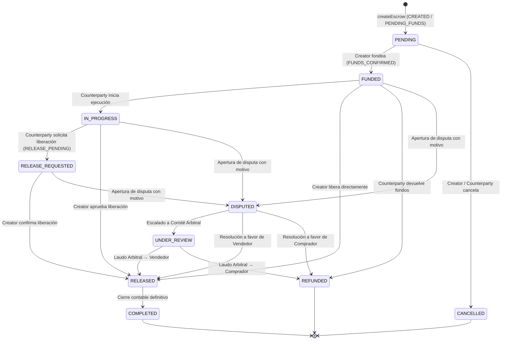

# 🛡️ WORDVERSE — ARQUITECTURA DEL MÓDULO ESCROW Y MARCO DE REVISIÓN JURÍDICA

> [!CAUTION]
> **AVISO DE ALCANCE Y CUMPLIMIENTO LEGAL:**  
> El presente documento técnico-jurídico ha sido elaborado como insumo de ingeniería para revisión por parte del equipo legal y de cumplimiento (*Compliance*) de **Shest Labs**. **En ningún caso declara ni certifica por sí mismo la viabilidad legal definitiva del servicio de custodia en ninguna jurisdicción.** El módulo implementado en el repositorio corresponde exclusivamente a un **Prototipo Aislado de Simulación (Sandbox sin fondos reales ni llaves privadas)** y no debe conectarse a redes principales (*Mainnet*) sin dictamen jurídico y técnico favorable debidamente firmado.

---

## Fase A: Análisis del Modelo de Negocio y Operación

### 1. Participantes y Roles
| Rol en Sistema | Identificador Técnico | Descripción y Facultades |
| :--- | :--- | :--- |
| **Ordenante / Comprador** | `creator` (`creatorId`) | Inicia el contrato de depósito en garantía, define el activo, monto y condiciones de entrega, aporta el fondeo (`FUNDED`) y autoriza la liberación (`RELEASED`) tras verificar el cumplimiento. |
| **Beneficiario / Vendedor** | `counterparty` (`counterpartyId`) | Acepta el encargo comercial (`IN_PROGRESS`), ejecuta la prestación o entrega del activo/servicio y solicita la liberación de los fondos (`RELEASE_REQUESTED`). |
| **Agente de Custodia / Backend Autoritativo** | `Shest Backend Core` | Mantiene el libro mayor transaccional, verifica saldos previos al bloqueo, impide liberaciones duplicadas y ejecuta las transferencias contables. |
| **Árbitro de Disputas** | `arbiter` (`Shest Compliance`) | Interviene exclusivamente cuando una de las partes declara una controversia (`DISPUTED` → `UNDER_REVIEW`), evaluando evidencias para dictaminar liberación (`RELEASED`) o reembolso al comprador (`REFUNDED`). |

### 2. Responsabilidades y Flujo Operativo
1. **Activos Involucrados:** Unidades contables denominadas en `USDT (TRC20)` dentro del ecosistema Shest. En el entorno actual de WordVerse, **100% de los saldos son simulados en memoria/staging sin conexión a blockchain productiva**.
2. **Condiciones de Liberación:**
   - Conformidad explícita del `creator` tras la solicitud `RELEASE_REQUESTED` de la `counterparty`.
   - Liberación directa por parte del `creator` una vez el contrato está `FUNDED` o `IN_PROGRESS`.
   - Laudo arbitral emitido por `Shest Compliance` tras un estado `UNDER_REVIEW`.
3. **Condiciones de Cancelación y Reembolso:**
   - **Cancelación sin penalidad (`CANCELLED`):** Permitida antes de que el contrato haya sido fondeado (`PENDING`).
   - **Reembolso íntegro (`REFUNDED`):** Aplicable cuando el contrato ya fue fondeado (`FUNDED` o `IN_PROGRESS`) y la contraparte desiste del servicio, o por resolución arbitral a favor del comprador tras una disputa. Restituye atómicamente el saldo retenido al `creator`.
4. **Disputas y Evidencias (`DISPUTED` / `UNDER_REVIEW`):**
   - Cualquiera de las dos partes activas puede declarar el contrato en disputa si el estado es `FUNDED`, `IN_PROGRESS` o `RELEASE_REQUESTED`.
   - **Requisito obligatorio:** Toda transición a `DISPUTED` exige un **motivo fundamentado no vacío** (`disputeReason`), el cual queda estampado de forma inmutable en el registro de auditoría (`historyLog`).
5. **Responsabilidad de Custodia y Dependencias Externas:**
   - **WordVerse (Frontend Flutter / Three.js 3D)** actúa únicamente como **interfaz visual interactiva**. No almacena semillas criptográficas, no firma transacciones en cadena y no calcula saldos definitivos.
   - Toda la custodia lógica y futura integración con proveedores fiduciarios recae en el backend Java Spring Boot de **Shest Labs** (`https://api.shestlabs.com/v1`).

---

## Fase B: Marco para Revisión Jurídica y Regulatoria

Este apartado estructura los puntos críticos que el comité legal externo debe dictaminar antes de habilitar operaciones con valor real:

### 1. Jurisdicciones y Calificación Regulatoria
- **Estados Unidos:** Evaluar aplicabilidad de normativas federales (**FinCEN** — *Money Services Business / Money Transmitter*) y licencias estatales de transmisión de dinero (*Money Transmitter Licenses - MTL*) o leyes de custodia fiduciaria estatal.
- **Unión Europea:** Evaluar encuadre bajo el reglamento **MiCA** (*Markets in Crypto-Assets Regulation*) como Proveedor de Servicios de Criptoactivos (**CASP**), específicamente en servicios de custodia, administración y transferencia de tokens referenciados a activos (*ART*) o *e-money tokens* (*EMT*).
- **América Latina (Colombia, México, Brasil, El Salvador, Argentina):** Evaluar registro como **PSAV / VASP** (*Proveedor de Servicios de Activos Virtuales*), normativas de la UIAF / CNBV / Banco Central y restricciones cambiarias sobre liquidación de contratos comerciales B2B en activos digitales.

### 2. Naturaleza Jurídica del Servicio
- Determinar si la plataforma opera como:
  - **Opción A (Proveedor Tecnológico / SaaS No Custodio):** Donde la custodia es ejecutada al 100% por un tercero regulado (proveedor de custodia con licencia o contrato inteligente auditable sin llaves de administración de la empresa).
  - **Opción B (Agente de Escrow / Custodio Directo):** Lo cual exige constituir vehículo fiduciario o contar con licencia de entidad de pago/custodia en cada jurisdicción operativa.

### 3. Prevención de Lavado de Activos y Financiación del Terrorismo (AML / CFT)
- **KYC / KYB Obligatorio:** Verificación de identidad de personas naturales y beneficiarios finales (*UBO*) de las empresas participantes en las salas VIP antes de habilitar contratos mayores a umbrales regulatorios.
- **Travel Rule (GAFI / FATF Recomendación 16):** Transmisión segura de metadatos del ordenante y beneficiario en operaciones que superen el umbral regulatorio (ej. 1,000 USD/EUR).
- **Monitoreo de Listas Restrictivas:** Cruce automatizado en el backend contra listas OFAC, ONU, UE, Interpol y PEPs antes de permitir `createEscrow` o `transitionEscrowState`.

### 4. Protección al Consumidor y Protección de Datos
- **Cláusulas Contractuales:** Redacción de un *Acuerdo Maestro de Escrow* que regule tiempos máximos de revisión, costos de arbitraje, exención de responsabilidad por fluctuación de red y procedimiento de entrega de pruebas.
- **Privacidad de Datos (GDPR / CCPA / Ley 1581):** Las minutas, chats y motivos de disputa contienen secretos empresariales B2B; deben almacenarse cifrados en reposo (AES-256) y en tránsito (TLS 1.3), con políticas claras de retención y derecho de supresión (salvo obligación legal de conservación contable por 5–10 años).

---

## Fase C: Evaluación Técnica Comparativa de Modelos de Custodia

| Criterio | 1. Proveedor Especializado Regulado (Fireblocks / BitGo / Custodio Licenciado) | 2. Custodia Administrada en Backend Propio (Shest Core DB + Hot/Warm Wallet) | 3. Contrato Inteligente Multisig On-Chain (TRON TRC20 / EVM Multi-Sig 3-de-5) |
| :--- | :--- | :--- | :--- |
| **Seguridad Criptográfica** | **Muy Alta:** MPC (*Multi-Party Computation*) + HSM grado bancario FIPS 140-2 Nivel 3. | **Media-Baja:** Riesgo de compromiso de servidor o llaves en memoria si no se usan HSMs dedicados. | **Alta:** Inmutable en cadena, sujeto a auditoría formal del *Smart Contract* (CertiK / OpenZeppelin). |
| **Complejidad Regulatoria** | **Menor para WordVerse:** El proveedor absorbe la licencia técnica de custodia (según contrato). | **Muy Alta:** Convierte a la empresa operadora en custodio directo de fondos de terceros. | **Media:** Si las llaves son 100% de los usuarios + 1 llave de arbitraje sin acceso unilateral (*Non-custodial*). |
| **Costos Operativos** | Suscripción mensual institucional + comisión por volumen (BPS). | Costo de infraestructura Cloud + seguro de ciberseguridad costoso. | Gas / Energy en red TRON (variable por congestión de red TRC20) por cada cambio de estado. |
| **Recuperación ante Fallos** | SLA 99.99%, recuperación asistida con quórum institucional. | Depende de respaldos de base de datos PostgreSQL y bóveda KMS. | Irreversible en cadena; requiere lógica de *Timelock* de emergencia en el contrato. |
| **Latencia de Experiencia UX** | Instantánea en libro interno; 3–30 seg en liquidación en cadena. | Instantánea (< 150 ms) por ser registro en base de datos relacional. | 3–15 segundos por bloque confirmado + firma manual de billetera del usuario. |
| **Recomendación Arquitectónica** | **Recomendado para Fase Productiva Institucional** en conjunto con el backend de Shest Labs. | **Exclusivo para Prototipo Sandbox / Staging** (implementación actual sin fondos reales). | **Recomendado como evolución Web3 descentralizada** una vez auditado el contrato. |

---

## Fase D: Diseño Funcional, Máquina de Estados y Controles Anti-Doble Liberación

### 1. Catálogo de Estados Oficiales
El módulo soporta el ciclo completo de vida del contrato, alineando los estados de negocio con los códigos de la API de Shest:

### 2. Matriz de Autorización por Rol (`allowedNextStatesFor`)

| Estado Actual | Acciones Permitidas para `creator` (Comprador) | Acciones Permitidas para `counterparty` (Vendedor) | Acciones de Arbitraje (`arbiter`) |
| :--- | :--- | :--- | :--- |
| **`PENDING`** | `FUNDED`, `CANCELLED` | `CANCELLED` | — |
| **`FUNDED`** | `RELEASED`, `DISPUTED`, `REFUNDED` | `IN_PROGRESS`, `REFUNDED`, `DISPUTED` | — |
| **`IN_PROGRESS`** | `RELEASED`, `DISPUTED` | `RELEASE_REQUESTED`, `DISPUTED` | — |
| **`RELEASE_REQUESTED`** | `RELEASED`, `DISPUTED` | `DISPUTED` | — |
| **`DISPUTED`** | `UNDER_REVIEW`, `RELEASED` | `UNDER_REVIEW`, `REFUNDED` | `UNDER_REVIEW`, `RELEASED`, `REFUNDED` |
| **`UNDER_REVIEW`** | — | — | `RELEASED`, `REFUNDED` |
| **`RELEASED`** | `COMPLETED` | `COMPLETED` | `COMPLETED` |
| **`COMPLETED` / `CANCELLED` / `REFUNDED`** | *(Ninguna — Estado Terminal Inmutable)* | *(Ninguna — Estado Terminal Inmutable)* | *(Ninguna — Estado Terminal Inmutable)* |

### 3. Controles de Seguridad Financiera Implementados en el Prototipo
1. **Bloqueo de Estados Terminales (`ESCROW_TERMINAL_STATE`):** Una vez que un contrato alcanza `COMPLETED`, `CANCELLED` o `REFUNDED`, cualquier intento de transición posterior es rechazado inmediatamente.
2. **Prevención de Doble Liberación (`isFundsSettled`):** La acreditación de saldo a la contraparte (`RELEASED` / `COMPLETED`) o el reembolso al creador (`REFUNDED` / `CANCELLED` tras fondeo) se ejecuta **exactamente una vez** verificando el estado previo.
3. **Idempotencia de Transición (`ESCROW_DUPLICATE_TRANSITION`):** Enviar dos veces el mismo estado objetivo arroja excepción controlada sin duplicar movimientos en el libro de billetera ni en el `historyLog`.
4. **Motivo Obligatorio en Disputas (`ESCROW_DISPUTE_REASON_REQUIRED`):** No se permite pasar a `DISPUTED` sin adjuntar una justificación auditable.

---

## Fase E: Aprobaciones Pendientes antes de Producción

| Área Responsable | Requisito de Salida a Producción | Estado Actual |
| :--- | :--- | :---: |
| **Dirección Jurídica & Compliance** | Dictamen legal sobre licencias VASP/MTL por país y aprobación de Términos y Condiciones de Escrow. | ⏳ `PENDIENTE DE FIRMA` |
| **Oficial de Cumplimiento (MLRO)** | Integración de proveedor KYC/AML y reglas de bloqueo OFAC en el backend de Shest Labs. | ⏳ `PENDIENTE DE FIRMA` |
| **Arquitectura Backend (Shest Labs)** | Conexión de endpoints productivos `POST /escrow/create` y `POST /escrow/{id}/transition` con bloqueo transaccional `SELECT ... FOR UPDATE` en PostgreSQL. | ⏳ `EN STAGING / SANDBOX` |
| **Ingeniería WordVerse (Prototipo Fase 5)** | Simulación aislada sin fondos reales, matriz contextual por rol, historial de auditoría, flujo de disputa y sincronización con Kiosco 3D. | ✅ `COMPLETADO EN SANDBOX` |
