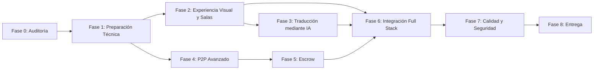

# 🗺️ WORDVERSE — ROADMAP MAESTRO DE IMPLEMENTACIÓN (FASES 0 A 8)

**Proyecto:** WordVerse 3D Business & Networking Hub (Integrado con Shest Labs)  
**Arquitectura:** Flutter (`3.47.5` / Dart `3.13.4`) + Motor 3D WebGL Three.js (`r160` en `web/hub3d`) + Adaptador Tri-Entorno (`MockShestApi` / Supabase PostgREST & Realtime / Shest Java Spring Boot API)  
**Última actualización:** 2026-10-30 — **TODAS LAS FASES COMPLETADAS (100%)**

---

## Diagrama General de Fases y Dependencias

---

## Fase 0: Auditoría

### Épica E0.1 — Auditoría Arquitectónica, Inventario Técnico y Planificación Base
- **Objetivo:** Levantar el estado real del repositorio, tecnologías, versiones, contratos con Shest Labs, estado de salas públicas/privadas y riesgos técnicos sin alterar la lógica de negocio existente.
- **Prioridad:** Crítica (`P0`)
- **Estimación:** 4 horas
- **Dependencias:** Ninguna
- **Archivos involucrados:**
  - `src/wordverse/pubspec.yaml`
  - `src/wordverse/docs/00_contrato_api_shest_fase0.md`
  - `src/wordverse/docs/02_hotspots_colisiones_y_spawn.md`
  - `src/wordverse/docs/implementation/ROADMAP.md`
  - `src/wordverse/docs/implementation/TASKS.md`
  - `src/wordverse/docs/implementation/STATUS.md`
  - `src/wordverse/docs/implementation/DECISIONS.md`
  - `src/wordverse/docs/implementation/RISKS.md`
- **Tareas y Subtareas:**
  - `WV-001`: Auditar arquitectura Frontend (Flutter + WebGL `hub3d`), Backend Adapters (`ShestApiClient`) y esquema SQL (`supabase_schema.sql`).
    - `WV-001.1`: Verificar versiones de SDK y paquetes (`Flutter`, `Dart`, `Three.js`, `http`, `web_socket_channel`, `qr_flutter`).
    - `WV-001.2`: Auditar matriz de requerimientos (incluyendo verificación de ausencia de archivos de audio en el repo para no inventar requisitos).
  - `WV-002`: Auditar implementación actual de Wallet, P2P, Escrow, QR, Networking y Salas Públicas/Privadas.
  - `WV-003`: Generar los 5 documentos oficiales de gestión en `docs/implementation/`.
- **Criterios de aceptación:**
  1. Inventario real documentado con evidencia de archivos y pruebas actuales (`20/20` tests en Dart y `physics.test.mjs` en Node).
  2. Documentos `ROADMAP.md`, `TASKS.md`, `STATUS.md`, `DECISIONS.md` y `RISKS.md` creados y trazables por ID.
- **Pruebas necesarias:**
  - Ejecución de línea base: `flutter test --no-pub` y `node src/wordverse/web/hub3d/test/physics.test.mjs`.

---

## Fase 1: Preparación Técnica

### Épica E1.1 — Estandarización de Design System, Tokens y Adaptadores de Entorno
- **Objetivo:** Consolidar los tokens visuales (`WordVerseTokens`), el tema global (`WordVerseTheme`), el contrato del puente `Hub3DProtocol` y la conmutación limpia entre entornos (`Mock`, `Supabase Staging`, `Production Java API`).
- **Prioridad:** Alta (`P0`)
- **Estimación:** 6 horas
- **Dependencias:** `WV-001`, `WV-002`, `WV-003` (Fase 0 completada)
- **Archivos involucrados:**
  - `src/wordverse/lib/core/theme/wordverse_tokens.dart`
  - `src/wordverse/lib/core/theme/wordverse_theme.dart`
  - `src/wordverse/lib/core/api_client/shest_api_client.dart`
  - `src/wordverse/lib/core/api_client/shest_backend_adapter.dart`
  - `src/wordverse/lib/features/wordverse/3d_room/hub3d/hub3d_protocol.dart`
- **Tareas y Subtareas:**
  - `WV-101`: Consolidar tokens de diseño PREMION / WordVerse (`#0A0A0C` Negro Obsidiana, `#D4AF37` Oro Premium, `#FFD978` Oro Luminoso, `#00F0FF` Cian Holográfico, `#00FF87` Verde Esmeralda).
  - `WV-102`: Validar y endurecer el contrato `ShestBackendAdapter` y `Hub3DProtocol` (incluyendo sincronización de `subRoomChanged`, `moved`, `interact`, `avatarTapped`).
  - `WV-103`: Estandarizar configuración por variables de entorno (`SUPABASE_URL`, `SUPABASE_ANON_KEY`, `SHEST_API_URL`, `SHEST_API_TOKEN`) y diagnóstico de salud de red (`verifyRemoteConnection`).
- **Criterios de aceptación:**
  1. Cero colores hardcodeados fuera de la paleta en componentes nuevos.
  2. Conmutación en caliente entre `Mock`, `Supabase Staging` y `Production` sin reiniciar la escena 3D.
- **Pruebas necesarias:**
  - `test/nexus_tokens_and_theme_test.dart`
  - `test/hub3d_protocol_test.dart`

---

## Fase 2: Experiencia Visual y Salas

### Épica E2.1 — Perfeccionamiento Arquitectónico del Lobby 3D, Mezzanine y Sala Privada VIP (The Boardroom)
- **Objetivo:** Garantizar una experiencia visual impecable sin solapamientos geométricos ni de HUD entre el Lobby Público (Atrio + Mezzanine) y la Sala Privada VIP (The Boardroom), con los logos oficiales del ecosistema y navegación fluida.
- **Prioridad:** Alta (`P0`)
- **Estimación:** 10 horas
- **Dependencias:** `WV-101`, `WV-102`
- **Archivos involucrados:**
  - `src/wordverse/web/hub3d/src/world.js`
  - `src/wordverse/web/hub3d/src/main.js`
  - `src/wordverse/web/hub3d/src/physics.js`
  - `src/wordverse/web/hub3d/src/avatars.js`
  - `src/wordverse/web/hub3d/index.html`
  - `src/wordverse/lib/features/wordverse/screens/public_hub_screen.dart`
  - `src/wordverse/lib/features/wordverse/screens/private_suites_screen.dart`
  - `src/wordverse/lib/features/wordverse/3d_room/wordverse_module_screen.dart`
- **Tareas y Subtareas:**
  - `WV-201`: Eliminar elementos innecesarios en planta baja que atraviesen la losa del Mezzanine (`pubPortalGroup` izquierdo) y ajustar la altura del portal de `SALA PRIVADA VIP` (`y <= 3.84m < 3.99m`) para que el piso del Mezzanine luzca limpio.
  - `WV-202`: Integrar los logos oficiales de las 4 compañías del ecosistema (`AURUM HEX · SHEX`, `SHEST COFFEE · BITCOFFEE`, `CYBER WOLF · P2P`, `WORDVERSE VR`) y el Monumento Central en la Sala Privada VIP.
  - `WV-203`: Garantizar postura anatómica de avatares sentados en sillas directivas (radio `3.05m` fuera de la mesa de `2.50m`) y retorno exacto al punto de entrada al salir de la Sala Privada VIP.
  - `WV-204`: Conectar el catálogo de Salas Públicas (`PublicHubScreen`) y Suites Privadas (`PrivateSuitesScreen`) con el estado de sub-sala activa y aforo en tiempo real.
- **Criterios de aceptación:**
  1. Ningún cartel o estructura de planta baja sobresale en el piso del Mezzanine (`y = 4.20m`).
  2. Entrar y salir de la Sala Privada VIP devuelve al jugador exactamente al portal de origen sin rebote.
  3. El avatar se sienta sobre el cojín de las sillas ejecutivas sin atravesar la mesa y permanece sentado hasta pulsar `E` o moverse.
- **Pruebas necesarias:**
  - `node src/wordverse/web/hub3d/test/physics.test.mjs`
  - `test/public_and_private_rooms_test.dart`
  - `test/hub_scene_test.dart`

---

## Fase 3: Traducción mediante IA

### Épica E3.1 — Traducción Multilingüe en Tiempo Real y Copiloto Ejecutivo Nexus AI
- **Objetivo:** Permitir que ejecutivos de distintos países negocien en salas públicas, privadas y chat de Networking con traducción asistida por IA (ES / EN / PT / ZH / FR) y minutas ejecutivas inteligentes con Nexus AI.
- **Prioridad:** Media-Alta (`P1`)
- **Estimación:** 12 horas
- **Dependencias:** `WV-204`
- **Archivos involucrados:**
  - `src/wordverse/lib/core/models/shest_models.dart`
  - `src/wordverse/lib/features/wordverse/meetings/networking_chat_sheet.dart`
  - `src/wordverse/web/hub3d/src/main.js`
  - `src/wordverse/web/hub3d/src/audio.js`
  - `src/wordverse/lib/core/api_client/shest_backend_adapter.dart`
- **Tareas y Subtareas:**
  - `WV-301`: Diseñar servicio de traducción IA (`WordverseTranslationService`) con soporte de idioma preferido por usuario (`es`, `en`, `pt`, `zh`) y caché local de traducciones.
    - `WV-301.1`: Añadir selector de idioma de traducción automática en `NetworkingAndChatSheet` y en el chat de salas privadas.
    - `WV-301.2`: Mostrar globo bilingüe en mensajes de chat (texto original + traducción instantánea al idioma del receptor).
  - `WV-302`: Integrar traducción de voz/subtítulos y generación de Minuta Ejecutiva Bilingüe en el Copiloto **Nexus AI** dentro de The Boardroom (`hub3d`).
  - `WV-303`: Exponer endpoint/adaptador de traducción en `ShestApiClient` para delegar al motor LLM corporativo de Shest cuando esté en modo `production`.
- **Criterios de aceptación:**
  1. Un usuario con idioma `EN` o `PT` visualiza los mensajes de chat traducidos automáticamente junto con el indicador del idioma original.
  2. Nexus AI genera minutas de reunión en la Sala Privada en el idioma seleccionado.
- **Pruebas necesarias:**
  - Pruebas unitarias de `WordverseTranslationService` (detección de idioma, traducción determinista en mock y fallback sin conexión).
  - Widget test del toggle de traducción en `NetworkingAndChatSheet`.

---

## Fase 4: P2P Avanzado

### Épica E4.1 — Libro de Órdenes P2P Avanzado, Filtros Multicriterio y Cotización Delegada a Shest
- **Objetivo:** Evolucionar el módulo P2P de WordVerse para soportar filtrado avanzado (compra/venta, método de pago, rango de monto, reputación de comerciante verificado) y vinculación directa con Escrow sin ejecutar lógica financiera local.
- **Prioridad:** Alta (`P1`)
- **Estimación:** 14 horas
- **Dependencias:** `WV-102`
- **Archivos involucrados:**
  - `src/wordverse/lib/core/models/shest_models.dart`
  - `src/wordverse/lib/core/api_client/p2p_service.dart`
  - `src/wordverse/lib/core/mocks/mock_shest_api.dart`
  - `src/wordverse/lib/core/api_client/http_shest_api.dart`
  - `src/wordverse/lib/features/wordverse/meetings/p2p_wallet_sheet.dart`
  - `src/wordverse/lib/features/wordverse/meetings/escrow_p2p_modals.dart`
- **Tareas y Subtareas:**
  - `WV-401`: Ampliar el modelo `P2POperation` (manteniendo compatibilidad hacia atrás) con tipo de orden (`BUY` / `SELL`), límites (`minAmount`, `maxAmount`), badge de verificación del maker y tasa de completitud.
  - `WV-402`: Implementar barra de filtros en `P2PAndWalletSheet` (por método de pago: `Wire`, `SEPA`, `Transferencia`, `USDT TRC20`, y ordenamiento por mejor tasa).
  - `WV-403`: Implementar flujo de creación y cancelación de orden P2P desde UI conectado a `POST /p2p/orders` y `POST /p2p/orders/{id}/cancel` de `ShestP2PService`.
- **Criterios de aceptación:**
  1. Todas las validaciones de saldo y cambios de estado P2P son resueltos por `ShestP2PService` (nunca calculados localmente en la UI).
  2. El usuario puede filtrar órdenes P2P, crear una nueva oferta y cancelar una oferta propia abierta.
- **Pruebas necesarias:**
  - Pruebas unitarias de `ShestP2PService` (creación, filtrado, aceptación y cancelación).
  - Widget test de `P2PAndWalletSheet` validando filtros y creación de orden.

---

## Fase 5: Escrow

### Épica E5.1 — Máquina de Estados Completa de Escrow B2B, Hitos y Auditoría QR
- **Objetivo:** Consolidar el ciclo de vida completo de contratos Escrow (`PENDING` → `FUNDED` → `IN_PROGRESS` → `RELEASE_REQUESTED` → `RELEASED` / `DISPUTED` / `CANCELLED` / `COMPLETED`) con trazabilidad de hitos, validación de contraparte y código QR verificable.
- **Prioridad:** Crítica (`P0`)
- **Estimación:** 14 horas
- **Dependencias:** `WV-401`
- **Archivos involucrados:**
  - `src/wordverse/lib/core/api_client/escrow_service.dart`
  - `src/wordverse/lib/core/models/shest_models.dart`
  - `src/wordverse/lib/features/wordverse/meetings/escrow_sheet.dart`
  - `src/wordverse/lib/features/wordverse/meetings/escrow_p2p_modals.dart`
  - `src/wordverse/lib/features/wordverse/meetings/meetings_qr_modals.dart`
- **Tareas y Subtareas:**
  - `WV-501`: Validar transiciones permitidas por rol (`creatorId` vs `counterpartyId`) en `EscrowCenterSheet` delegando la autorización a `PATCH /escrows/{id}/state`.
  - `WV-502`: Añadir línea de tiempo visual (Audit Trail / `historyLog`) y desglose de condiciones comerciales en cada tarjeta de Escrow (`#45821`).
  - `WV-503`: Integrar apertura rápida de disputa (`DISPUTED`) con motivo obligatorio y vinculación directa con el Kiosco Comercial 3D (`hub3d`).
- **Criterios de aceptación:**
  1. El flujo `PENDING` → `FUNDED` → `IN_PROGRESS` → `RELEASE_REQUESTED` → `RELEASED` → `COMPLETED` funciona de extremo a extremo y actualiza el historial de auditoría.
  2. Escaneo o ingreso del payload `SHEST-ESCROW:45821:...` en el validador QR abre el detalle exacto del contrato.
- **Pruebas necesarias:**
  - Pruebas unitarias de las 8 transiciones de `EscrowStatus` en `test/widget_test.dart` y nueva suite `test/escrow_lifecycle_test.dart`.

---

## Fase 6: Integración Full Stack

### Épica E6.1 — Sincronización Extremo a Extremo (Flutter ↔ Three.js ↔ Supabase / Shest Java API)
- **Objetivo:** Unificar la persistencia y eventos en tiempo real entre el cliente 3D, Flutter, Supabase PostgREST/Realtime y el contrato REST de Shest Labs.
- **Prioridad:** Alta (`P0`)
- **Estimación:** 12 horas
- **Dependencias:** `WV-204`, `WV-303`, `WV-503`
- **Archivos involucrados:**
  - `src/wordverse/lib/core/api_client/http_shest_api.dart`
  - `src/wordverse/lib/features/wordverse/multiplayer/multiplayer_service.dart`
  - `src/wordverse/supabase_schema.sql`
  - `src/wordverse/docs/00_contrato_api_shest_fase0.md`
- **Tareas y Subtareas:**
  - `WV-601`: Sincronizar el catálogo de salas públicas/privadas y presencia multiusuario (`room_presence`) con `HttpShestApi` y `WordverseMultiplayerService`.
  - `WV-602`: Sincronizar las compras con Escrow realizadas desde el Kiosco Comercial 3D (`hub3d`) hacia `ShestEscrowService` en Flutter mediante el puente `bridge.js`.
  - `WV-603`: Validar manejo de sesiones JWT (`loginWithShestSession`, `refreshSession`) y cabeceras de autorización hacia `https://api.shestlabs.com/v1`.
- **Criterios de aceptación:**
  1. Las interacciones iniciadas dentro del lienzo WebGL (Kiosco, Hotspots, Portales, Asientos) se reflejan en el estado de Flutter y en el bus de eventos `WordverseEventBus`.
  2. El modo offline/fallback actúa sin bloquear la UI cuando no hay credenciales remotas configuradas.
- **Pruebas necesarias:**
  - Pruebas de integración del adaptador `HttpShestApi` con cliente HTTP simulado (`MockClient`).

---

## Fase 7: Calidad y Seguridad

### Épica E7.1 — Seguridad RBAC, Políticas RLS, Resiliencia de Red y Suite de Pruebas
- **Objetivo:** Endurecer la seguridad de acceso a salas privadas, políticas RLS de base de datos, validación de entradas y cobertura de pruebas automatizadas.
- **Prioridad:** Alta (`P0`)
- **Estimación:** 10 horas
- **Dependencias:** `WV-601`, `WV-602`, `WV-603`
- **Archivos involucrados:**
  - `src/wordverse/supabase_schema.sql`
  - `src/wordverse/lib/features/wordverse/models/private_room.dart`
  - `src/wordverse/lib/features/wordverse/screens/private_suites_screen.dart`
  - `src/wordverse/test/`
- **Tareas y Subtareas:**
  - `WV-701`: Separar políticas RLS en `supabase_schema.sql` entre modo desarrollo (`anon` para staging) y políticas restrictivas de producción basadas en `auth.uid()`.
  - `WV-702`: Verificar control de permisos por rol (`OWNER`, `MODERATOR`, `MEMBER`, `GUEST`) en `PrivateRoom` y expiración/revocación de tokens de invitación.
  - `WV-703`: Ejecutar auditoría estática (`flutter analyze`) y ampliar cobertura de pruebas unitarias, de widgets y de física 3D.
- **Criterios de aceptación:**
  1. `flutter analyze` sin errores y `100%` de pruebas pasando en `flutter test` y `physics.test.mjs`.
  2. Usuarios con rol `GUEST` no pueden modificar diapositivas ni aprobar liberaciones de Escrow reservadas a las partes del contrato.
- **Pruebas necesarias:**
  - `flutter analyze`
  - `flutter test --no-pub`
  - `node src/wordverse/web/hub3d/test/physics.test.mjs`

---

## Fase 8: Entrega

### Épica E8.1 — Empaquetado Final, Documentación de Handover y Certificación de Release
- **Objetivo:** Entregar el build Web/Móvil optimizado, la guía de conexión para el equipo de Backend Java de Shest Labs y el reporte final de certificación de calidad.
- **Prioridad:** Media (`P1`)
- **Estimación:** 4 horas
- **Dependencias:** `WV-701`, `WV-702`, `WV-703`
- **Archivos involucrados:**
  - `src/wordverse/docs/00_contrato_api_shest_fase0.md`
  - `src/wordverse/docs/implementation/STATUS.md`
  - `src/wordverse/build/web/`
- **Tareas y Subtareas:**
  - `WV-801`: Compilar paquete Web de producción (`flutter build web --no-pub`) sincronizando los assets 3D de `web/hub3d/`.
  - `WV-802`: Actualizar matriz de cierre en `STATUS.md` y `TASKS.md` con evidencia de pruebas y capturas.
- **Criterios de aceptación:**
  1. Build Web funcional a 60 FPS con Smart LOD activo y todos los documentos de `docs/implementation/` actualizados a estado final.
- **Pruebas necesarias:**
  - Smoke test completo sobre el servidor HTTP de producción local (`serve_web.js`).
